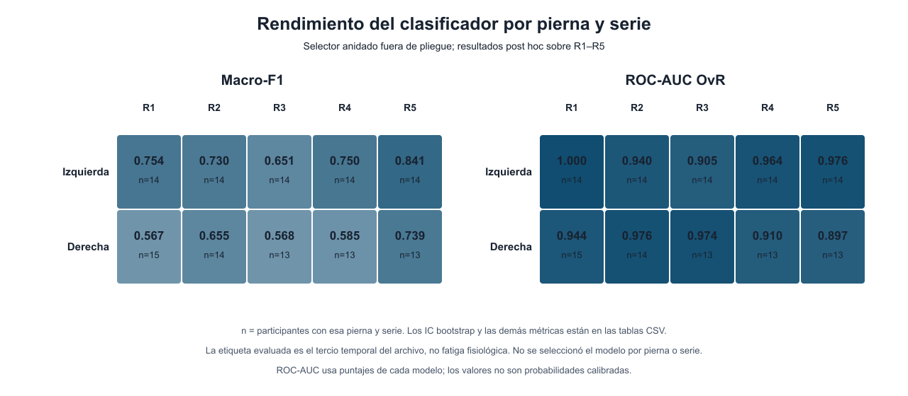

# Resultados agregados por pierna y serie (F31)

## Alcance y denominadores

La auditoría reutiliza las predicciones fuera de pliegue del benchmark anidado hecho solo con las grabaciones locales. Participante es la unidad estadística; no se volvió a entrenar ni seleccionar un modelo por lado. El corpus contiene 15 grupos derivados de los códigos de archivo. En R1–R5 hay 70 grabaciones izquierdas de 14 grupos y 68 derechas de 15; 14 grupos tienen datos pareados de ambas piernas. En total se comparan 414 segmentos de tercios temporales. R0 y R0_1 quedaron fuera del benchmark y se usaron solo en control de calidad.

## Resumen por pierna

| Pierna registrada | Grupos | Grabaciones | Segmentos | Macro-F1 (IC 95 %) | Exactitud balanceada | ROC-AUC OvR | AP macro OvR | MCC |
|---|---:|---:|---:|---:|---:|---:|---:|---:|
| Izquierda | 14 | 70 | 210 | 0,776 (0,675–0,874) | 0,800 | 0,961 | 0,937 | 0,735 |
| Derecha | 15 | 68 | 204 | 0,686 (0,611–0,762) | 0,720 | 0,951 | 0,929 | 0,628 |

En los 14 grupos pareados, la diferencia izquierda menos derecha de Macro-F1 fue +0,092 (IC 95 % −0,052 a +0,238). Los intervalos pareados de exactitud balanceada, ROC-AUC, AP y MCC también abarcaron cero. El mayor punto estimado a izquierda no demuestra una diferencia reproducible entre lados.

## Desglose por serie

| Pierna | Serie | Grupos | Segmentos | Macro-F1 | ROC-AUC OvR |
|---|---:|---:|---:|---:|---:|
| Izquierda | R1 | 14 | 42 | 0,754 | 1,000 |
| Izquierda | R2 | 14 | 42 | 0,730 | 0,940 |
| Izquierda | R3 | 14 | 42 | 0,651 | 0,905 |
| Izquierda | R4 | 14 | 42 | 0,750 | 0,964 |
| Izquierda | R5 | 14 | 42 | 0,841 | 0,976 |
| Derecha | R1 | 15 | 45 | 0,567 | 0,944 |
| Derecha | R2 | 14 | 42 | 0,655 | 0,976 |
| Derecha | R3 | 13 | 39 | 0,568 | 0,974 |
| Derecha | R4 | 13 | 39 | 0,585 | 0,910 |
| Derecha | R5 | 13 | 39 | 0,739 | 0,897 |

Las comparaciones pareadas por serie usaron 14, 13, 12, 12 y 12 grupos para R1–R5, respectivamente. Son exploratorias por el tamaño reducido, cobertura desigual y cinco contrastes.

## Interpretación

Las etiquetas representan el tercio temprano, medio o tardío de cada archivo. No representan repeticiones observadas, fatiga percibida, caída de fuerza ni diagnóstico fisiológico. Los resultados describen la clasificación de posición temporal por lado registrado. No demuestran asimetría neuromuscular ni detección de fatiga. El nombre de lado del archivo tampoco confirma el músculo anatómico medido.
